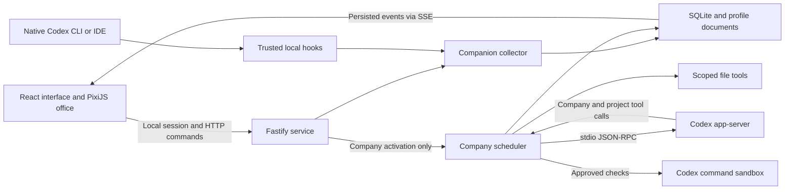

# Architecture and behavior

## Components

`server/codex.ts` owns executable discovery, the version pin, authentication state, request correlation, protocol timeouts, and process lifecycle. It does not implement application policy.

`server/engine.ts` owns policy: conversation scopes, employee dispatch, dependencies, project locks, approvals, direct-edit evidence, token budgets, review/repair, personalization, and interruption. Native delegation is disabled; company task creation is the sole scheduling route.

`server/files.ts` mediates text access and verifies canonical paths and expected hashes. `server/store.ts` owns SQLite records, durable events, exports, and generated profile documents. Records use a versioned SQLite schema with JSON payloads; the current database `user_version` is 2.

The singleton background service can observe native Codex without creating an Engine. Only Company activation performs scheduler recovery. Shared roles and approved preferences are reused across modes, while native Codex owns its delegation, tools, and approvals. See [Companion architecture](companion.md) for installation, collection, privacy, and native compatibility boundaries.

## Request flow

1. A user message creates a persistent work request, user message, and CEO job.
2. The browser presents one company-wide CEO conversation. Names in the message resolve a project; clear follow-ups inherit the preceding user request's project. Ambiguous references stay in Company context for clarification. Each resolved project retains its own internal CEO thread and serialized queue, so tools, tasks, budgets, and evidence remain scoped. Recent conversational context carries project labels across these internal threads.
3. The CEO answers or calls `company_create_task`. Tool dispatch derives the project and request from the live session, never from a model-provided arbitrary filesystem root.
4. The scheduler reserves slots before starting worker threads. Dependencies must already exist in the same project and request, preventing dependency cycles and cross-project links.
5. Employees receive bounded briefs, project context, relevant prerequisite evidence, and role-scoped tools. Native tools are disabled or denied; writes go through guarded company tools.
6. Completed developer work schedules review. A review requesting changes can schedule at most two repair cycles, each followed by review.
7. Results, findings, and change evidence are saved before the CEO is notified. Automatic review/repair avoids a redundant CEO progress turn.
8. The CEO retrieves scoped task/evidence records and explains the result. Historical evidence is distinguished from fresh verification.

## Application interfaces

- `GET /api/session`: establishes an HttpOnly, SameSite local cookie and returns a mutation token held in memory by the frontend.
- `GET /api/snapshot`: current company records and runtime state.
- `GET /api/events`: reconnectable SSE activity stream plus snapshot-invalidation events.
- `POST /api/projects`: register a canonical, non-overlapping project folder.
- `POST /api/messages`: submit a message; browser chat sends a null project ID and the engine resolves named projects or conversational follow-ups. Explicit scoped API requests remain supported.
- `POST /api/folders/pick`: authenticated native Windows Common Item Dialog; returns one absolute folder path or cancellation, without registering the project or starting execution.
- `POST /api/codex/{connect,login,refresh,verify}`: connection and managed authentication.
- `POST /api/company/{pause,resume}`: company execution controls.
- `POST /api/tasks/:id/{cancel,resume,priority}`: assignment controls.
- `POST /api/requests/:id/extend`: explicitly add the configured default budget to one request.
- `POST /api/approvals/:id`: accept once, answer a question, or decline.
- `POST /api/profile`, `POST /api/preferences`, and `POST /api/preferences/:id`: personal preferences and versioned approval/undo.
- `POST /api/settings`: model, concurrency, and default budget.
- `GET /api/export`, `POST /api/backup`: local portability and recovery.

Mutations require the local cookie and `X-Company-Token`. The service validates Host and Origin, rejects cross-site requests, binds to loopback, renders Markdown without raw HTML, and keeps provider credentials out of frontend state.

## State and recovery

Assignments transition from queued to working/reviewing, optionally awaiting input, then completed, failed, cancelled, interrupted, or blocked. Failed prerequisites block dependent work. Cancellation requests do not release a live writer’s lock until turn completion confirms interruption. Windows sandbox checks cannot be individually terminated: stopping state holds the project lock until the check finishes or reaches its two-minute timeout. Graceful service shutdown drains these bounded checks.

The soft request budget is aggregate reported usage, not output tokens alone. A warning is emitted at 80%; crossing the limit pauses that request, interrupts its sessions, and prevents new assignments. An explicit extension unlocks scheduling; interrupted tasks still require deliberate resumption.

On Company activation after service restart, active tasks and pending CEO jobs become interrupted. Partial evidence remains intact. Queued CEO messages are not silently replayed; the conversation explains that the user must continue deliberately. Pending approvals expire on activation rather than being accepted implicitly. Visualizer-only startup leaves Company assignments untouched.

## Deliberate boundaries

This is a single-user local product with provider-backed inference. It is not a cloud service, autonomous business, VM, local language model, or exact simulation of the user’s reasoning. There are no external app integrations or automatic publishing actions.

The command sandbox and project file mediator have different boundaries. Project file tools are scope-enforced; approved executable scripts can still read whatever the native sandbox allows. Every command requires user approval, and network access is disabled. A stronger untrusted-code boundary would require a separately provisioned container or VM.
